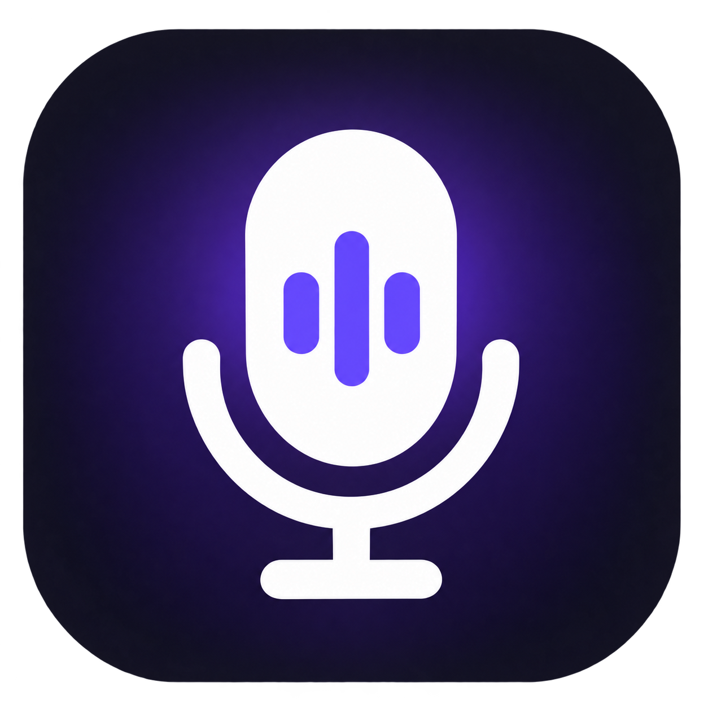

# Nemo Voice Typing: free offline voice typing for Windows



Nemo is a free, open-source dictation app for Windows 10 and 11. Press **Ctrl+Alt+A** or click the floating mic, say what you want to write, and the words show up in whatever text field you're in.

The speech recognition runs on your own CPU with an NVIDIA NeMo streaming model. After the first model download it works offline, so nothing you say goes to a transcription service.

I use it for messages, notes, searches and long prompts, anywhere I'd rather talk than type.

[](https://www.youtube.com/watch?v=k6MXKX_60T0)

## What you get

- **Works in any app.** It types into the active text field, using a global shortcut or the floating mic.
- **Private and offline.** Speech is processed on your PC after the one-time model download. No telemetry.
- **Edit by voice.** Say "new line," "period," "delete last" or "scratch that."
- **Personal dictionary.** Add names, places and terms it often mishears.
- **No GPU needed.** A normal x64 CPU with AVX2 is enough.

## Install

1. Download **Nemo Voice Typing.exe** from [GitHub Releases](https://github.com/Garnet-Owl/nemo-voice-typing/releases).
2. Run it. A floating mic appears near the right edge of the screen and a tray icon appears in the notification area.
3. Click into any text field and press **Ctrl+Alt+A** or click the mic. The first time, it downloads the speech model (about 700 MB) from [Hugging Face](https://huggingface.co/Garnet-Owl/nemo-voice-typing-asr).
4. Talk normally. Press the shortcut or click the mic again to stop.

The model is cached in `%LOCALAPPDATA%\NemoVoiceTyping\models\`. By default Nemo stops listening after 30 seconds without speech. Click the empty area of the floating control to change that.

## Controls

| Action | How |
| --- | --- |
| Start or stop dictation | **Ctrl+Alt+A** or click the floating mic |
| Move the control | Drag the floating pill |
| Hide the control | Right-click the pill, then **Hide panel** |
| Show the control | Left-click the tray icon |
| Edit your dictionary | Right-click the tray icon, then **Personal dictionary...** |
| Start with Windows | Right-click the tray icon, then **Start with Windows** |
| Exit | Right-click the tray icon, then **Exit** |

## Voice commands

| Say | You get |
| --- | --- |
| "period," "comma," "question mark," "colon," "semicolon," "exclamation mark" | The punctuation mark |
| "new line" or "new paragraph" | A line break or a blank line |
| "delete last" | The last word removed |
| "scratch that" or "delete that" | The last sentence removed |

Punctuation from the model is kept, sentences start with a capital, and your personal dictionary fixes terms it keeps getting wrong.

## Requirements

- Windows 10 or 11 on x64 with an AVX2-capable CPU. No GPU.
- [.NET 8 Desktop Runtime](https://dotnet.microsoft.com/download/dotnet/8.0). Windows offers to install it if you don't have it.
- About 700 MB of disk space for the model and about 800 MB of RAM while it runs.
- Releases are x64. You can build ARM64 from source.

## Settings

Settings live in `%APPDATA%\NemoVoiceTyping\config.json`. You can change `Hotkey` and `TextInjection` there.

`TextInjection` defaults to `auto`. It types with keystrokes, but pastes into Windows 11 Notepad, because Notepad can drop simulated keystrokes. Set it to `clipboard` to always paste, or `keystrokes` to never touch the clipboard.

## Build from source

Install the [.NET 8 SDK](https://dotnet.microsoft.com/download/dotnet/8.0), then on Windows:

```powershell
git clone https://github.com/Garnet-Owl/nemo-voice-typing
cd nemo-voice-typing
dotnet publish src/NemoVoiceTyping/NemoVoiceTyping.csproj -c Release -r win-x64 `
    --self-contained false -p:PublishSingleFile=true `
    -p:IncludeNativeLibrariesForSelfExtract=true -o dist
```

The executable is `dist\Nemo Voice Typing.exe`. For a native ARM64 build, use `-r win-arm64` and a separate output folder.

It's built with WPF, NAudio, ONNX Runtime and the Win32 hotkey and text input APIs.

## Contributing and license

Bug reports and pull requests are welcome. [CONTRIBUTING.md](CONTRIBUTING.md) covers setup and tests.

The app code is MIT licensed. The speech model has its own terms, on the [model page](https://huggingface.co/Garnet-Owl/nemo-voice-typing-asr).

If you want to record a new demo, there's a [script and video prompt](VIDEO_DEMO_SCRIPT.md).
