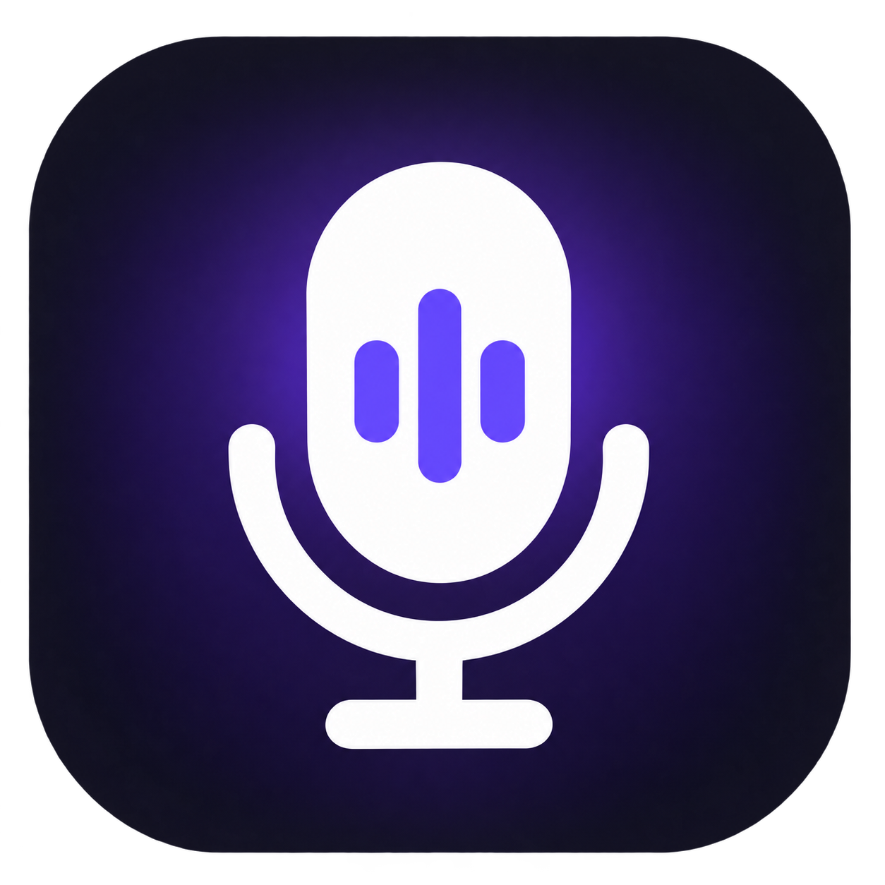

# Nemo Voice Typing



**Free, open-source voice typing for Windows.** Press **Ctrl+Alt+A** or click
the floating microphone, speak, and your words appear in the focused text
field. Nemo runs speech recognition locally on your CPU with an NVIDIA NeMo
streaming model. After the first model download, dictation works offline.

Useful for writing messages, notes, searches, and long prompts without
switching apps or sending your speech to a transcription service.

## What it does

| Feature | What you get |
| --- | --- |
| Dictate across Windows | Type into the active text field with a global shortcut or the floating mic. |
| Private, offline recognition | Speech is processed on your PC after the one-time model download; no telemetry. |
| Quick editing by voice | Say “new line,” “period,” “delete last,” or “scratch that.” |
| Personal dictionary | Add names, places, and terms that are often misheard. |
| Flexible controls | Move the always-on-top mic, change its idle timeout, or start Nemo with Windows. |

## Get started

1. Download **Nemo Voice Typing.exe** from
   [GitHub Releases](https://github.com/Garnet-Owl/nemo-voice-typing/releases).
2. Run it. The floating microphone appears near the right edge of the screen,
   and a tray icon appears in the notification area.
3. Place your cursor in a text field and press **Ctrl+Alt+A** or click the mic.
   The first use downloads the roughly 700 MB speech model from
   [Hugging Face](https://huggingface.co/Garnet-Owl/nemo-voice-typing-asr).
4. Speak normally. Press the shortcut or click the mic again to stop.

The model is cached under `%LOCALAPPDATA%\NemoVoiceTyping\models\`.
Nemo stops listening after 30 seconds without recognized speech by default.
Click the empty area of the floating control to change the timeout.

| Action | Control |
| --- | --- |
| Start or stop dictation | **Ctrl+Alt+A** or click the floating mic |
| Move the control | Drag the floating pill |
| Hide the control | Right-click the pill → **Hide panel** |
| Show the control | Left-click the tray icon |
| Edit personal vocabulary | Right-click the tray icon → **Personal dictionary...** |
| Start with Windows | Right-click the tray icon → **Start with Windows** |
| Exit | Right-click the tray icon → **Exit** |

### Voice commands

| Say | Result |
| --- | --- |
| “period,” “comma,” “question mark,” “colon,” “semicolon,” or “exclamation mark” | Insert punctuation |
| “new line” or “new paragraph” | Insert a line break or blank line |
| “delete last” | Remove the last word |
| “scratch that” or “delete that” | Remove the last sentence |

Model punctuation is preserved, sentence starts are capitalized, and the
personal dictionary can correct frequently misheard terms.

## Requirements and settings

- Windows 10 or 11 on x64 with an AVX2-capable CPU; no GPU required.
- [.NET 8 Desktop Runtime](https://dotnet.microsoft.com/download/dotnet/8.0).
  Windows offers to install it if needed.
- Approximately 700 MB of disk space for the model and around 800 MB of RAM
  while running. Releases currently provide x64 builds; ARM64 can be built
  from source.

Settings are saved in `%APPDATA%\NemoVoiceTyping\config.json`. You can change
`Hotkey` and `TextInjection` there. `TextInjection` defaults to `auto`: it
types with keystrokes, but pastes into Windows 11 Notepad because Notepad can
drop simulated keystrokes. Set it to `clipboard` to always paste or
`keystrokes` to never use the clipboard.

## Watch the demo

[](https://www.youtube.com/watch?v=k6MXKX_60T0)

A [short recording script and video-generation prompt](VIDEO_DEMO_SCRIPT.md)
are available if you want to make a new demo.

## Build from source

Install the [.NET 8 SDK](https://dotnet.microsoft.com/download/dotnet/8.0),
then run on Windows:

```powershell
git clone https://github.com/Garnet-Owl/nemo-voice-typing
cd nemo-voice-typing
dotnet publish src/NemoVoiceTyping/NemoVoiceTyping.csproj -c Release -r win-x64 `
    --self-contained false -p:PublishSingleFile=true `
    -p:IncludeNativeLibrariesForSelfExtract=true -o dist
```

The executable is `dist\Nemo Voice Typing.exe`. For a native ARM64 build,
use `-r win-arm64` and a separate output folder. The app uses WPF, NAudio,
ONNX Runtime, and the Win32 global hotkey and text input APIs.

## Contributing and license

Bug reports and pull requests are welcome. See [CONTRIBUTING.md](CONTRIBUTING.md)
for setup and tests. The application code is MIT licensed. The speech model
has separate terms; see the
[model page](https://huggingface.co/Garnet-Owl/nemo-voice-typing-asr).
